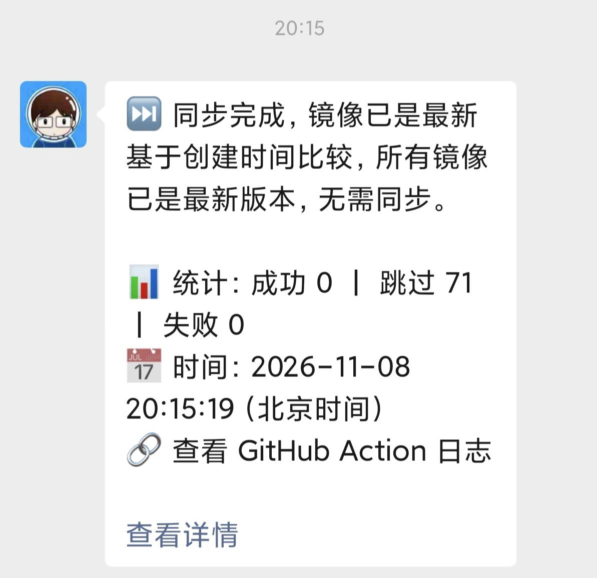

# Aliyun Image Pusher

> 基于 GitHub Actions 的镜像中转工具（Fork 优化版）

把 Docker Hub、`ghcr.io` 等公共镜像**自动同步到阿里云容器镜像服务（ACR）**，解决国内拉取慢、拉取失败的问题。

同步完全在 GitHub 托管 runner 上完成：用 `skopeo` 在源 registry 与目标 registry 之间**直传**，不经过 Docker daemon、不落 Docker 存储、不需要自己的服务器或 NAS。当前 `images.txt` 维护 71 个镜像，目标为 ACR **公开仓库**。

## ✨ 当前特性

| 特性 | 说明 |
| --- | --- |
| 仓库直传 | `skopeo copy` 端到端直传 + `--dest-creds` 认证，不再 `docker pull / tag / push` |
| 增量同步 | 先并行（`xargs -P 4`）比对源与目标，仅同步需要更新的镜像 |
| 磁盘保护 | 只删除 runner 预装工具链腾空间、**不重分区**；每个镜像同步前检查根盘水位，≥90% 主动熔断 |
| zstd 自适应 | ACR 个人版不接受 zstd 层，按源清单 `layers[].mediaType` 自动识别并强制转 gzip，不硬编码镜像名 |
| 凭据隔离 | Docker Hub PAT 只发给 Docker Hub，`ghcr.io` 等第三方源保持匿名 |
| 固定环境 | `runs-on: ubuntu-24.04` + `actions/checkout@v7`，规避系统镜像漂移与 Node 20 弃用警告 |
| 通知 | Server酱 微信推送，每次运行发送 Markdown 摘要（只列新增 / 失败，含统计与日志链接），Turbo / ³ 自动适配 |

## 🚀 快速开始

### 1. 配置 Secrets

在 `Settings → Secrets and variables → Actions → New repository secret` 中添加：

| 名称 | 必填 | 说明 |
| --- | --- | --- |
| `ALIYUN_REGISTRY` | ✅ | ACR 地址，如 `registry.cn-beijing.aliyuncs.com` |
| `ALIYUN_NAME_SPACE` | ✅ | 命名空间，如 `wangboyu-images` |
| `ALIYUN_REGISTRY_USER` | ✅ | ACR 用户名 |
| `ALIYUN_REGISTRY_PASSWORD` | ✅ | ACR 访问令牌（临时密码，非账号登录密码） |
| `DOCKERHUB_USER` | 可选 | Docker Hub 用户名 |
| `DOCKERHUB_TOKEN` | 可选 | Docker Hub **Personal Access Token**，建议 `Repo Read-only` + 设置到期日 |
| `SERVERCHAN_SENDKEY` | 可选 | Server酱 SendKey（`SCT` 或 `sctp` 开头均可），用于微信通知 |

不配 Docker Hub 凭据也能运行，但匿名拉取容易撞 Docker Hub 限流。两条 PAT 建议成对配置；工作流会按 registry 白名单分发凭据，**不会**把它发给 `ghcr.io` 等第三方源。

> ⚠️ PAT 与 SendKey 只写进 Secrets，不要写进 `images.txt`、`docker.yaml` 或提交记录；GitHub 会在日志中自动打码。

### 2. 编辑镜像列表

修改 `images.txt`，每行一个镜像，支持 `#` 注释、第三方 registry、以及指定架构：

```text
# 官方镜像
mariadb
postgres:17-alpine

# Docker Hub 组织镜像
jxxghp/moviepilot-v3
ponphil/litepan:beta

# 第三方 registry（匿名访问）
ghcr.io/homarr-labs/homarr

# 指定架构：--platform 必须写在行首，镜像名放在最后
--platform=linux/arm64 linuxserver/transmission
```

说明：

- 不写 tag 时目标名也不带 `:latest` 字面，Docker 会按约定解析为 `latest`。
- `@sha256:` 摘要会被去掉，以 tag 为准。
- **`--platform` 必须写在镜像名之前**。脚本用 `awk '{print $NF}'` 取镜像名，若写成 `nginx:latest --platform=linux/arm64`，镜像名会被误解析成 `--platform=linux/arm64`，整行同步失败。

### 3. 触发同步

| 方式 | 触发条件 | 时间 |
| --- | --- | --- |
| 定时 | `schedule: '17 10,22 * * *'` | 每天 **UTC 10:17 / 22:17**（北京 **18:17 / 06:17**） |
| 自动 | push 到 `main` 且**只有 `images.txt` 变更** | 提交后立即 |
| 手动 | `Actions → Docker Image Sync to Aliyun → Run workflow` | 随时 |

⚠️ **修改 `.github/workflows/docker.yaml` 本身不会触发 CI**（`on.push.paths` 只含 `images.txt`）。改完工作流必须手动 `Run workflow` 验证，否则会出现「提交完没反应」。

**为什么是 `:17` 而不是整点**：GitHub 官方文档说明 `schedule` 按 UTC 执行，且「每小时的开头」属于高负载时段，此时定时事件可能被延迟，排队过久的作业甚至会被直接丢弃。2026-11-08 北京 18:00 那次就整点未触发（当天凌晨的定时也普遍漂移 3~7 小时），改为 UTC 10:17 / 22:17 避开拥堵。GitHub 不保证精确到分钟，实际开始时间仍可能略晚，属正常现象；同步逻辑幂等，晚跑不会重复推送镜像（只会让通知晚到）。

同一时间只会跑一个同步任务（`concurrency: aliyun-image-sync`，`cancel-in-progress: false`）：定时任务运行中手动触发会**排队**，不会打断正在跑的任务。

## 📝 命名转换规则

目标地址统一为：

```text
$ALIYUN_REGISTRY/$ALIYUN_NAME_SPACE/<镜像名:tag>
```

**取源镜像最后一段**（最后一个 `/` 之后的部分），不带组织名前缀：

| 源镜像（`images.txt`） | ACR 目标 |
| --- | --- |
| `jxxghp/moviepilot-v3` | `registry.cn-beijing.aliyuncs.com/wangboyu-images/moviepilot-v3` |
| `ponphil/litepan:beta` | `.../litepan:beta` |
| `postgres:17-alpine` | `.../postgres:17-alpine` |
| `mariadb` | `.../mariadb` |
| `ghcr.io/homarr-labs/homarr` | `.../homarr` |

两个例外，都会加前缀：

- **跨命名空间同名**：两个不同组织出现同名镜像时，自动加 `<命名空间>_` 前缀避免覆盖（当前清单检测结果为 0 个重名）。
- **指定平台**：`--platform=linux/arm64` 会加 `linux_arm64_` 前缀。

> 早期 README 把规则描述为「`组织名_镜像名`」，与实际代码不符，已在本版更正。

## ⚙️ 同步判定与工作原理

1. **预处理**：扫描 `images.txt`，解析命名空间、平台、目标名，检测重名冲突。
2. **并行检查**（4 并发）：用 `skopeo inspect` 读源与目标清单。
   - 目标不存在 → 需要同步
   - **优先比较 `Created` 创建时间**：源比目标新 → 同步；相同或更旧 → 跳过
   - 时间解析失败时回退比较 digest，再回退比较镜像大小
3. **串行同步**：`skopeo copy --override-os linux --override-arch <arch> --dest-creds …`，重试 3 次、单镜像超时 900 秒；每轮无论成败都清理临时 blob。

**为什么用创建时间而不是 digest？** 同步时会从多架构 index 中只抽取 `linux/amd64` 子镜像；且 ACR 上的历史镜像经旧版 `docker pull/tag/push` 推送后，manifest 会被 Docker daemon 重写成 Docker schema2（OCI ↔ schema2、`zstd` ↔ `gzip` 都会改变层 digest）。因此**源与目标的 manifest digest 天然不相等**，直接比较会导致每轮全量重推。`Created` 来自 config blob，跨 registry 转换保持不变，是这里可用的稳定判据。

代价：若上游对同一 tag 重推但固定了 `Created`（可复现构建 / `SOURCE_DATE_EPOCH`），会漏同步。可定期手动强制重推，或改用比较 `config.digest` 的方案（`rootfs.diff_ids` 同样不受压缩格式影响）。

## 🧩 zstd 压缩层处理

ACR 个人版上传 zstd 层会返回 `unknown: blob type invalid`。上游 `diygod/rsshub` 等镜像使用 `tar+zstd` 层；旧版 `docker pull/tag/push` 会由 Docker daemon 顺带重压成 gzip，改成 skopeo 直传后这层隐式转换消失，因此需要显式处理。

工作流按源清单的 `layers[].mediaType` **自动检测**：仅当源含 zstd 层时，才拉取 `quay.io/skopeo/stable:v1.22.3` 并加 `--dest-force-compress-format --dest-compress-format gzip --format v2s2`；其余镜像仍走系统自带的 skopeo 1.13.3 原路径。转 gzip 不改变 `config.digest` / `Created` / `rootfs.diff_ids`，因此不会破坏上面的增量判据。

> 系统 apt 版 skopeo 1.13.3 的 `--dest-compress-format` 不会重压已压缩层，`--dest-force-compress-format` 要到 1.21+ 才提供，所以这一步必须用新版。若 `quay.io` 不可达会打印警告并退回原路径，仅影响 zstd 镜像。

## 🔔 微信通知（Server酱）

在 [sct.ftqq.com](https://sct.ftqq.com) 微信扫码获取 SendKey、绑定推送通道后，把值填进 Secret **`SERVERCHAN_SENDKEY`**。工作流在任务结束时（`if: always()`）发一条消息，**每次运行都推**，包括「全部已是最新」：

| 运行情况 | 消息标题 |
| --- | --- |
| job 异常终止 | 🚨 同步任务异常终止 |
| 有镜像同步失败 | ❌ 阿里云镜像同步失败 |
| 有新增同步 | ✅ 阿里云镜像同步成功 |
| 全部跳过 | ⏭️ 同步完成，镜像已是最新 |

正文是 Markdown（Server酱 的 `desp` 字段），**只列 ✨ 新增与 🚨 失败镜像**；`⏭️` 跳过项不逐条推送，只在统计里体现一次，避免全跳过时刷出几十行。此外还有成功 / 跳过 / 失败统计、**北京时间**时间戳（UTC+8，Action 日志也会打印便于核对）和**可点击的 GitHub 日志链接**。标题只由 `title` 参数显示一次，正文不再重复。

**通知预览**（全跳过场景，2026-11-08 20:15 北京时间，run `42478865178`）：



> 标题由 `title` 参数渲染一次，正文从 `$CONTENT` 开始，不再重复标题；时间戳为北京时间（UTC+8），与 Action 日志里的「🕐 通知时间」一致。全跳过时清单为空，跳过数量看统计行。

有新增或失败时，正文才会出现 `- ✨ xxx` / `- 🚨 xxx (同步失败)` 列表项。Action 日志会同步打印「📋 通知明细（仅新增 / 失败）」便于核对；完整 `SYNC_RESULT`（含全部跳过项）仍保留在日志中供排查。

**两种 SendKey 自动适配**：`SCT` 开头走 Server酱Turbo（`https://sctapi.ftqq.com/{key}.send`）；`sctp` 开头走 Server酱³（自动从 `sctp<uid>t…` 解析 uid，请求 `https://{uid}.push.ft07.com/send/{key}.send`）。不需要手动填地址或区分版本。

> ⚠️ SendKey 会出现在请求 URL 里，不要打印到日志、不要写进代码或提交记录。工作流用 `--data-urlencode` 发送中文 / emoji / Markdown，以返回 JSON 的 `code == 0` 判定成功；失败重试 3 次后只发 `::warning::`，**不影响同步结果**。

未配置 `SERVERCHAN_SENDKEY` 时打印「跳过微信通知」，其余流程不受影响。免费版额度 5 条/天，每天 2 次定时 + 偶尔手动触发足够；**会员不受此限制**，可放心手动触发验证。

## 🔍 每日失败巡检

WorkBuddy 自动化任务「镜像同步失败巡检」每天 **北京时间 07:00** 运行一次，覆盖过去 30 小时内的两次定时运行（北京 18:17 / 06:17）；**成功时静默，不产生任何报告**：

- 检查 Actions 结论（`failure` / `cancelled` / `timed_out` / `action_required`，以及卡住超过 1 小时的 `in_progress`）；
- 即使结论是 `success`，也会读日志末尾 `成功: N, 跳过: N, 失败: N` 汇总行，失败数 > 0 同样报警，专门兜住下面的「假绿」；
- 异常时报告 run id / URL、失败 job/step、失败镜像名、关键日志片段、根因与可执行修复建议。

排查重点包含 ENOSPC、Docker Hub 限流 / 401、skopeo 认证、`ImageOS` / `ImageVersion` 漂移、ACR `blob type invalid`，以及 Server酱 通知步骤是否发送成功（通知失败只发 `::warning::`，不影响同步结论）。

> 若 GitHub 把定时事件延迟到 07:00 之后，该 run 仍落在 30 小时窗口内，会在次日巡检被检出，不会永久漏报。

## ⚠️ 已知限制

- **「假绿」**：单个镜像失败只累加失败计数、不会 `exit 1`，job 结论仍可能是 `success`。判断真实结果请看日志末尾的 `成功: N, 跳过: N, 失败: N` 汇总行（每日巡检已自动做这项检查）。
- **只同步单架构**：默认 `linux/amd64`；需要 arm64 请在 `images.txt` 用 `--platform` 逐行指定（注意写在行首）。
- **失败重试有上限**：3 次失败后跳过该镜像，等下一轮再试。
- **额外网络依赖**：仅 zstd 镜像会拉 `quay.io/skopeo/stable:v1.22.3`。
- **通知额度**：Server酱 免费版 5 条/天（会员不限），每次运行都推，每天 2 次定时约占 2 条；未配置 `SERVERCHAN_SENDKEY` 时静默跳过。
- **通知失败不影响结论**：推送失败只发 `::warning::`，判断同步结果请看日志汇总行或 Actions 结论。

## 📅 更新日志

见 [CHANGELOG.md](CHANGELOG.md)。

## 📄 许可证

[MIT](LICENSE)
